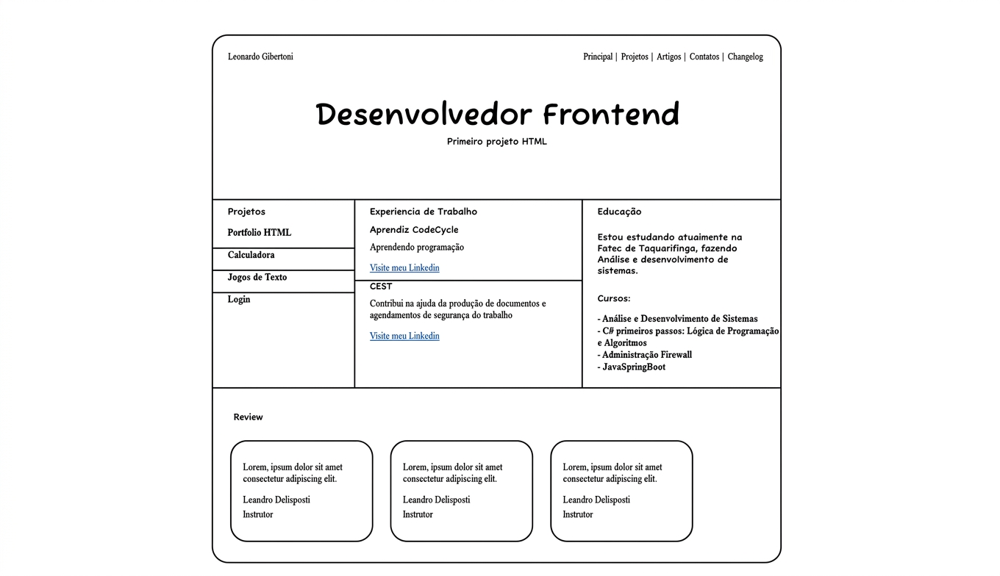
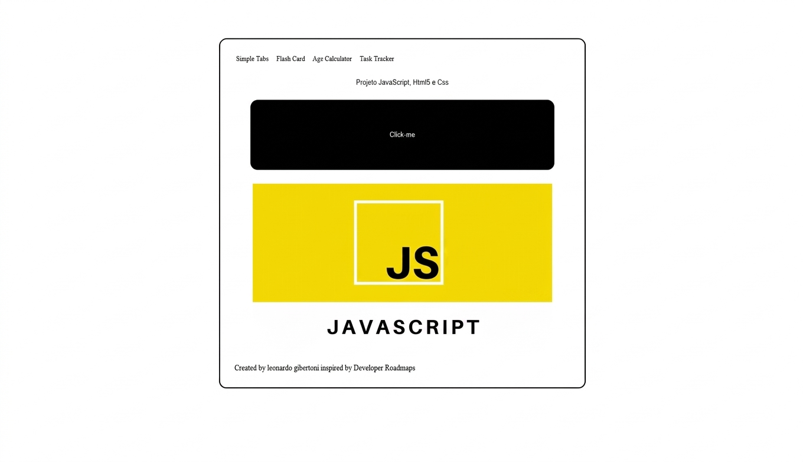

Desenvolvedor Full Stack, construo sites e aplicações web utilizando Angular, C# e SQL. Gosto de vibe coding, explorando novas ideias e usando IA para transformar conceitos em projetos funcionais. Atualmente, curso Análise e Desenvolvimento de Sistemas (ADS) na Fatec Taquaritinga, sempre buscando aprender novas tecnologias e evoluir como desenvolvedor.

Portfólio: [github.com/LeoGibertoni](https://github.com/LeoGibertoni)

## Projetos

