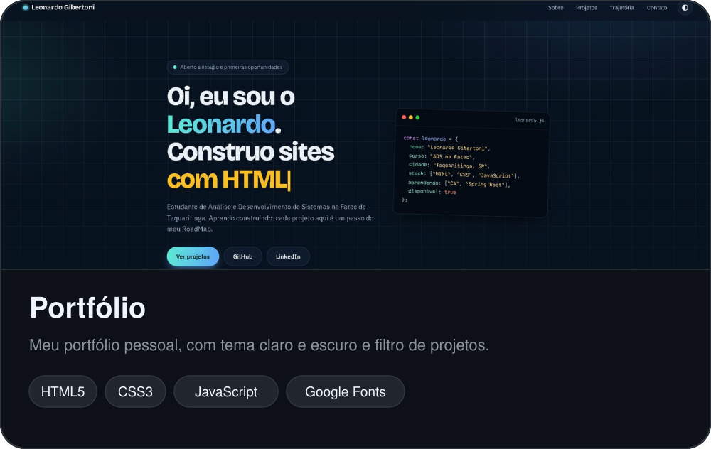
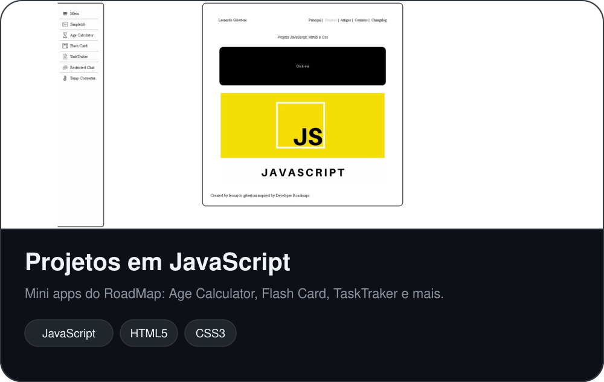
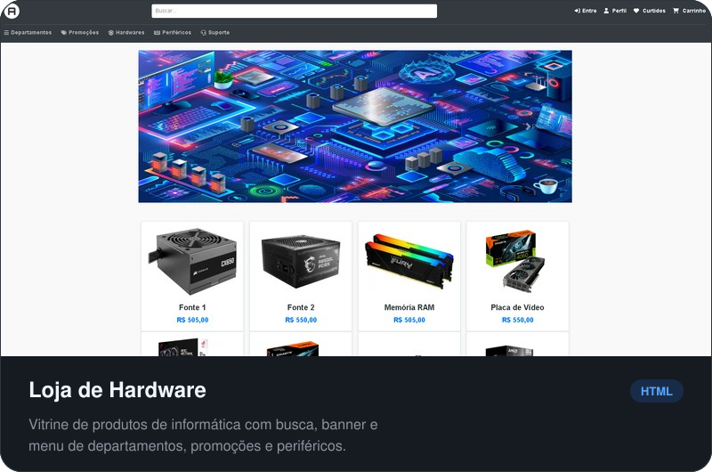
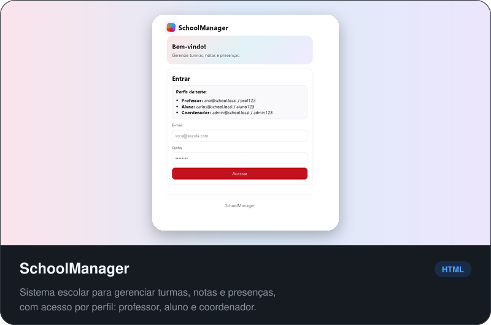

Desenvolvedor Full Stack, construo sites e aplicações web utilizando **Angular, C# e SQL**. Gosto de vibe coding, explorando novas ideias e usando IA para transformar conceitos em projetos funcionais. Atualmente, curso Análise e Desenvolvimento de Sistemas (ADS) na **Fatec Taquaritinga**, sempre buscando aprender novas tecnologias e evoluir como desenvolvedor.

## Atualmente

- Estudando na faculdade de Análise e Desenvolvimento de Sistemas (ADS)
- Aprendendo vibecoding

## Projetos

## Stack

## Contato

[gibertonileo@gmail.com](mailto:gibertonileo@gmail.com) &nbsp;&nbsp; [LinkedIn](https://br.linkedin.com/in/leonardo-gibertoni-b9b041329?trk=people-guest_people_search-card)