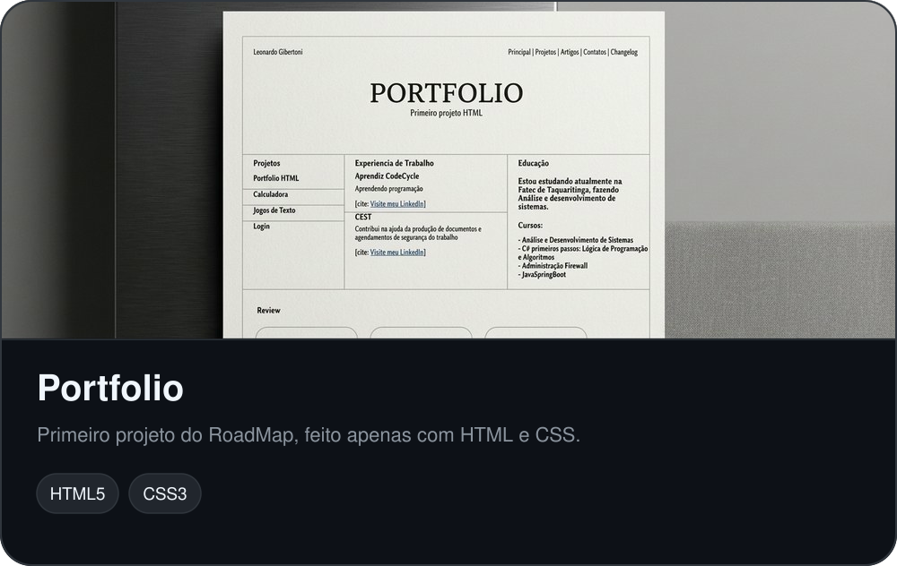
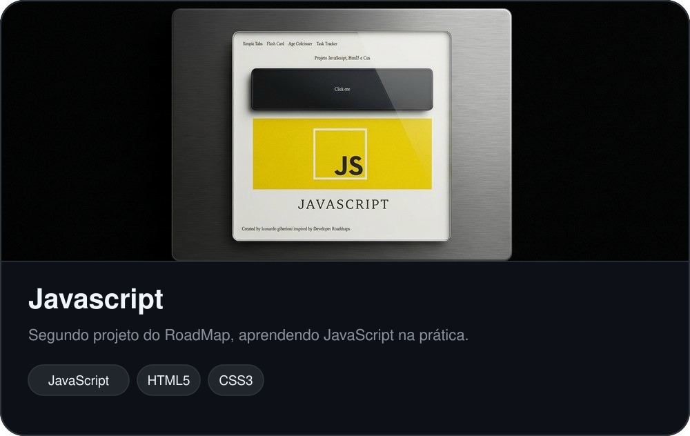

Desenvolvedor Full Stack, construo sites e aplicações web utilizando **Angular, C# e SQL**. Gosto de vibe coding, explorando novas ideias e usando IA para transformar conceitos em projetos funcionais. Atualmente, curso Análise e Desenvolvimento de Sistemas (ADS) na **Fatec Taquaritinga**, sempre buscando aprender novas tecnologias e evoluir como desenvolvedor.

## Currently

- Estudando POO em C#
- Evoluindo os projetos do RoadMap, de HTML e CSS até JavaScript

## Projetos

## Stack

## Contato

[gibertonileo@gmail.com](mailto:gibertonileo@gmail.com) &nbsp;&nbsp; [LinkedIn](https://br.linkedin.com/in/leonardo-gibertoni-b9b041329?trk=people-guest_people_search-card)